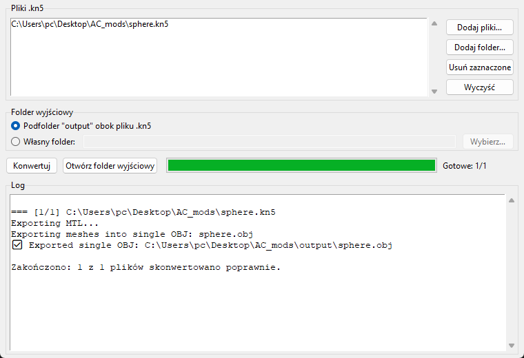

<div align="center">

# 🏎️ KN5 → OBJ Converter

**Wyciągnij modele 3D z Assetto Corsa i otwórz je w Blenderze.**

Konwertuje pliki `.kn5` (samochody, tory, obiekty) do formatu **Wavefront OBJ + MTL**
wraz ze wszystkimi teksturami – gotowe do importu w Blenderze, edycji i dalszego moddingu.


[**⬇️ Pobierz KN5Converter.exe**](../../releases/latest)



</div>

---

## ✨ Do czego to służy?

Assetto Corsa przechowuje modele w zamkniętym formacie `.kn5`, którego Blender nie otworzy.
Ten program rozpakowuje go do formatu, który rozumie każdy program 3D:

- 🔧 **Modyfikacja** istniejących aut i torów – poprawki geometrii, nowe części, body kity, spoilery
- ➕ **Dodawanie modeli** – dostawianie obiektów do toru (budynki, trybuny, reklamy, drzewa)
- 🎨 **Skiny i tekstury** – podgląd mapowania UV, eksport tekstur do edycji w GIMP/Photoshop
- 📐 **Referencja** – dokładne wymiary i skala modelu do budowy własnych assetów
- 🖼️ **Rendery** – wyświetlenie auta/toru w Blenderze (Cycles/Eevee)

## 🚀 Funkcje

| | |
|---|---|
| 📦 **Jeden plik `.exe`** | Bez instalacji, bez Pythona – pobierasz i uruchamiasz |
| 🗂️ **Konwersja wsadowa** | Dowolna liczba plików `.kn5` lub cały folder naraz |
| 🖱️ **Przeciągnij i upuść** | Upuść plik/folder na `KN5Converter.exe` – konwersja startuje sama |
| 🧱 **Pełna hierarchia** | Transformacje wszystkich węzłów są zaaplikowane – części trafiają na swoje miejsca |
| 🎨 **Materiały i tekstury** | Plik `.mtl` z kolorami, mapami diffuse/normal/alpha i wypakowane tekstury `.dds/.png` |
| 🔤 **Nazwy obiektów** | Każda siatka to osobny obiekt w Blenderze z oryginalną nazwą z KN5 |
| 💻 **Wiersz poleceń** | `conv.py` działa też bez okienka – do skryptów i automatyzacji |

## 💻 Wymagania systemowe

### Wersja `.exe` (zalecana)

| | Minimalne | Zalecane |
|---|---|---|
| **System** | Windows 10 64-bit | Windows 11 64-bit |
| **Procesor** | dowolny x86-64 (64-bit) | 4+ rdzenie, 3 GHz+ |
| **RAM** | 4 GB – pojedyncze auta | 8–16 GB – duże tory |
| **Dysk** | ~25 MB na program + miejsce na wynik* | SSD |
| **Karta graficzna** | nie jest wymagana | – |
| **Dodatkowe oprogramowanie** | **brak** (Python i biblioteki są w środku `.exe`) | – |

\* Plik `.obj` jest tekstowy i zajmuje zwykle **kilka razy więcej** niż geometria w `.kn5`, do tego dochodzą wypakowane tekstury.
Dla dużego toru przygotuj kilka GB wolnego miejsca.

> ℹ️ Windows 7 / 8 oraz systemy 32-bitowe **nie są obsługiwane**.

### Do dalszej pracy

- **Blender 2.80 lub nowszy** – [blender.org](https://www.blender.org/download/)
- Opcjonalnie: edytor grafiki obsługujący `.dds` (GIMP 2.10+, Paint.NET, Photoshop z wtyczką DDS)

### Uruchamianie z kodu źródłowego

- Python **3.10+** (64-bit) z modułem Tkinter (domyślnie w instalatorze z python.org)
- Pakiety z [`requirements.txt`](requirements.txt) (`numpy`)

## 📖 Jak używać

### 1. Konwersja

1. Pobierz `KN5Converter.exe` z zakładki [**Releases**](../../releases/latest).
2. Uruchom go i kliknij **Dodaj pliki…** lub **Dodaj folder…**
   (np. `assettocorsa\content\cars\<auto>\` albo `assettocorsa\content\tracks\<tor>\`).
3. Wybierz folder wyjściowy – domyślnie podfolder `output` obok pliku `.kn5`.
4. Kliknij **Konwertuj**, a po zakończeniu **Otwórz folder wyjściowy**.

Wynik:

```
output/
├── model.obj        ← geometria
├── model.mtl        ← materiały
└── texture/         ← wszystkie tekstury z pliku .kn5 (.dds / .png / .jpg)
```

> 💡 Szybciej: przeciągnij plik `.kn5` lub cały folder prosto na ikonę `KN5Converter.exe`.

### 2. Import do Blendera

| Blender | Menu |
|---|---|
| **4.x / 3.x** | `File → Import → Wavefront (.obj)` |
| **2.8x – 2.9x** | `File → Import → Wavefront (.obj)` (dodatek *Import-Export: Wavefront OBJ* musi być włączony) |

- Domyślne ustawienia osi (**Forward: -Z, Up: Y**) są poprawne – Assetto Corsa, tak jak OBJ, używa osi Y w górę.
- Skala: **1 jednostka = 1 metr**, tak samo jak w grze.
- Tekstury podepną się same, jeśli folder `texture/` leży obok pliku `.obj`.
- Każda część modelu jest osobnym obiektem – oryginalne nazwy z KN5 (np. `WHEEL_LF`, `STEER_HR`) zostają zachowane.

### 3. Powrót do gry (opcjonalnie)

Ten program działa **w jedną stronę** (KN5 → OBJ). Aby zmodyfikowany model wrócił do gry:

1. W Blenderze wyeksportuj model jako **FBX** (`File → Export → FBX`).
2. Otwórz FBX w **ksEditor** z oficjalnego Assetto Corsa SDK, ustaw shadery i materiały.
3. Zapisz jako `.kn5` i podmień w folderze `content`.

## ⌨️ Wiersz poleceń

Konwertuje wszystkie pliki `.kn5` z podanego folderu (wynik w `<folder>\output`):

```bash
pip install -r requirements.txt
python conv.py "C:\Steam\steamapps\common\assettocorsa\content\cars\moje_auto"
```

Wersja z okienkiem z kodu źródłowego:

```bash
python gui.py
```

## 🛠️ Budowanie `.exe` samodzielnie

```bash
build.bat
```

Skrypt tworzy środowisko `.venv`, instaluje [`requirements-build.txt`](requirements-build.txt) (numpy + PyInstaller)
i buduje `dist\KN5Converter.exe`.

## 📁 Struktura projektu

| Plik | Opis |
|---|---|
| `conv.py` | Parser formatu KN5 i eksporter OBJ/MTL (logika konwersji + CLI) |
| `gui.py` | Interfejs graficzny (Tkinter) |
| `build.bat` | Budowanie samodzielnego `.exe` (PyInstaller) |
| `requirements.txt` | Zależności do uruchomienia z kodu |
| `requirements-build.txt` | Zależności do budowania `.exe` |

## ⚠️ Ograniczenia

- **Zaszyfrowane / zabezpieczone pliki `.kn5`** (część płatnych modów) nie są obsługiwane.
- **Animacje i szkielet** – animowane siatki (np. kierowca) są eksportowane jako statyczna siatka, bez kości.
- Siatki o nazwach zaczynających się od `AC_` (obiekty techniczne gry) są pomijane.
- Shadery AC są uproszczone do standardowego materiału OBJ – w Blenderze materiały warto dopracować ręcznie
  (zwłaszcza szyby, lakier i mapy detali).
- Wynik nie jest konwertowany z powrotem do `.kn5` – do tego służy ksEditor (patrz wyżej).

## ❓ FAQ

**Windows SmartScreen pokazuje ostrzeżenie przy uruchomieniu.**
Plik `.exe` nie jest podpisany cyfrowo. Kliknij **Więcej informacji → Uruchom mimo to**.
Jeśli wolisz, zbuduj go samodzielnie z kodu (`build.bat`).

**Antywirus zgłasza plik.**
Programy spakowane PyInstallerem bywają fałszywie oznaczane. Kod jest w całości w tym repozytorium – możesz go przejrzeć i zbudować sam.

**Model w Blenderze jest bez tekstur.**
Upewnij się, że folder `texture/` leży obok pliku `.obj`, i włącz podgląd *Material Preview* (klawisz `Z`).

**Konwersja dużego toru trwa długo.**
To normalne – tory mają miliony wierzchołków, a OBJ jest formatem tekstowym. Postęp widać w oknie logu.

## ⚖️ Informacja prawna

Projekt jest narzędziem społeczności moderskiej, niezwiązanym z Kunos Simulazioni ani 505 Games.
*Assetto Corsa* jest znakiem towarowym jego właścicieli. Modele z gry i modów są chronione prawem autorskim –
konwertuj i publikuj zmodyfikowane modele wyłącznie, jeśli masz do tego prawo (własne modele lub zgoda autora).
